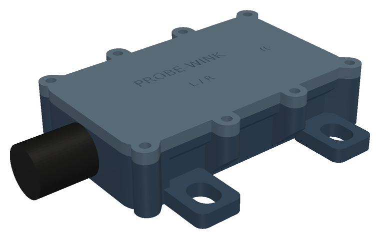
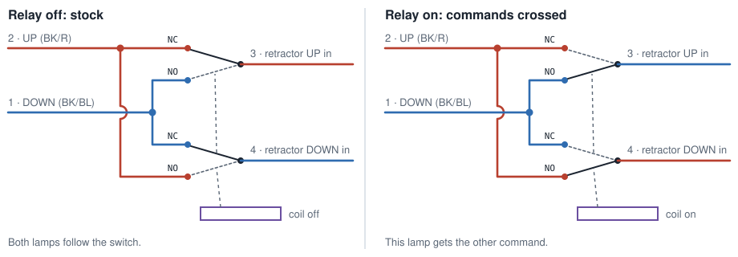

# probe-wink

Wink and alternation mod for the pop-up headlamps of the 1989–92 Ford Probe.
Each headlamp gets a small sealed module that plugs in between the factory
retractor plug and the retractor through a Y-adapter. A relay in the module
swaps the retractor's UP and DOWN command lines, so one lamp can go down while
the other stays up (a wink), or the two can flip in turn. With the relay off,
the car behaves exactly as stock. The LH module talks to a phone and a BLE
remote; the RH module follows it over an authenticated ESP-NOW link. Power
comes from the retractor's own feed; no wires go into the cabin.



## Status

| Part              | State                                                   |
|-------------------|---------------------------------------------------------|
| PCB (rev C)       | designed, ERC/DRC and layout checks pass; not yet built |
| Housing (rev C)   | designed and checked on the model; not yet printed      |
| Firmware          | logic unit-tested on the host; runs on an ESP32 devkit (boot, radio, BLE, phone pairing); not yet run on the module |
| Android app       | built with home-screen widgets; unit tests and lint pass; not yet run on a phone |
| On the car        | nothing tested yet                                      |

## How it works, in short



Both retractors hang on the same two command wires from the headlamp switch.
That is why the lamps always move together. Crossing the two wires for one
retractor sends that lamp the opposite way. Details:
[docs/how-it-works.md](docs/how-it-works.md).

## Documentation

- [How it works](docs/how-it-works.md)
- [Installation](docs/installation.md)
- [Using it](docs/using.md)
- [Building](docs/building.md)
- [Testing](docs/testing.md)
- [Design notes](docs/design-notes.md)

## Repository

| Path            | Contents                                                     |
|-----------------|--------------------------------------------------------------|
| `docs/`         | documentation and diagrams                                   |
| `pcb/`          | KiCad project, generated from Python (`schematic.py`, `check.py`, `board.py`, `fab.py`, `export_enclosure.py`); [README](pcb/README.md) |
| `enclosure/`    | 3D-printable housing in build123d (`housing.py`, `check.py`, `render.py`) |
| `firmware/`     | Rust on ESP-IDF for the ESP32-C3; [README](firmware/README.md) |
| `android/`      | Android app with home-screen widgets; [README](android/README.md) |
| `tools/kicad/`  | generic KiCad generator library used by `pcb/`               |
| `Makefile`      | one target per part                                          |

## Quick start

```sh
make pcb         # schematic -> ERC/netlist check -> board (route, DRC, layout checks) -> JLCPCB files
make enclosure   # board geometry -> housing STEP/STL -> enclosure checks -> renders
make firmware    # module firmware; needs WINK_ESPNOW_KEY and WINK_BLE_PASSKEY
make devkit      # the same firmware for an ESP32 DEVKITV1 test bench
make android     # Android app, debug APK
make test        # firmware logic tests + Android unit tests
```

What each target needs (KiCad 10, Freerouting, a Python venv for build123d,
the Rust toolchain): [docs/building.md](docs/building.md).

## Safety

- The module switches the command lines of the headlamp retractors. With the
  relay off, the wiring is stock: at power-up, in reset, in sleep, and without a
  module. Unplugging the Y-adapter restores the original wiring completely.
- Each module's 12 V tap runs through a 1 A fuse in the adapter. Motor power
  never passes through the module.
- The retractor linkage is strong enough to hurt. Disconnect the battery before
  working on it, and keep hands clear whenever it has power.
- Winking or flashing headlamps while driving may be illegal where you live.
  Treat both modes as parked-car features. The modules cannot see whether the
  car is moving.
- This is a hobby project, not yet tested on a car. Use it at your own risk.

## Licence

- **Software** (`firmware/`, `android/`, `tools/`, and the generator scripts in
  `pcb/` and `enclosure/`): [MIT](LICENSE).
- **Hardware design** (the KiCad files in `pcb/`, the housing models built by
  `enclosure/`): not decided yet.
