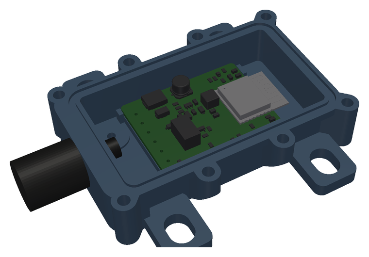

# Building

Per car: two modules (board, lead, housing), two Y-adapters
([installation.md](installation.md#the-y-adapter)), optionally one BLE
camera-shutter remote. Every part regenerates from source with one `make`
target; the per-part READMEs have the details.

| Part      | Command          | Details                                     |
|-----------|------------------|---------------------------------------------|
| PCB       | `make pcb`       | [pcb/README.md](../pcb/README.md)           |
| Housing   | `make enclosure` | `enclosure/housing.py` (docstring)          |
| Firmware  | `make firmware`  | [firmware/README.md](../firmware/README.md) |
| Android app | `make android` | [android/README.md](../android/README.md)   |

## 1. The PCB

The KiCad files are generated by the Python scripts in `pcb/`; edit those, not
the `.kicad_*` files.

```sh
make pcb    # schematic -> ERC + netlist check -> board (route, DRC, layout checks) -> fab files
```

Needs KiCad 10 (`pcbnew` Python module, `kicad-cli`), Freerouting on `PATH`
and `rsvg-convert`. The outputs land in `pcb/build/fab/`:

| File                                   | Upload to JLCPCB as     |
|----------------------------------------|-------------------------|
| `probe-wink-gerbers.zip`               | Gerber files            |
| `probe-wink-bom-jlc.csv`               | BOM (assembly)          |
| `probe-wink-cpl-jlc.csv`               | CPL / pick and place    |
| `probe-wink-assembly-{top,bottom}.pdf` | for you: every reference designator |

Ordering at JLCPCB: 2-layer board, 46 × 40 mm, top-side assembly of every part
marked `Assembly = SMT` (45 placements, 26 BOM lines). Order at least two.

- Check every part's rotation in JLC's placement preview. Record corrections in
  `ROT_OFFSET` in `pcb/fab.py` and regenerate. Already corrected (found in the
  preview, 2026-11-01): SOT-23 and TSOT-23-6 by 180° (Q1–Q3, U1), the relay K1 by 90°.
- The ESP32-C3-WROOM-02-N4 is rated −40…85 °C ambient. The -H4 (105 °C, LCSC
  C2944070) has the same pads but showed no stock at JLC on 2026-11-01;
  consider it for a hot mounting spot.
- The back side has no parts, only pads (J2, USB, JP1).

## 2. The lead

Sheathed 6 × 0.5 mm² cable, for example LiYY 6×0.5 (about 6.2 mm OD).

1. Thread the cable through the M12 gland and the housing's gland hole first.
2. Strip and solder the six wires into J1 (1.15 mm holes). The silkscreen names
   each pad:

   | J1 | Silkscreen | Goes to                               |
   |----|------------|---------------------------------------|
   | 1  | DN         | harness BK/BL (DOWN from the switch)  |
   | 2  | rU         | retractor BK/R (UP input)             |
   | 3  | UP         | harness BK/R (UP from the switch)     |
   | 4  | rD         | retractor BK/BL (DOWN input)          |
   | 5  | 12V        | BK/W tap, through the 1 A fuse        |
   | 6  | GND        | BK tap                                |

3. On the RH board only, bridge JP1 on the back with solder.

## 3. The housing



```sh
python3 -m venv enclosure/.venv
enclosure/.venv/bin/pip install -r enclosure/requirements.txt
make enclosure   # board geometry -> housing STEP/STL -> checks -> renders (needs f3d)
```

The first step exports the board's 3D model and geometry with `kicad-cli`
(`pcb/export_enclosure.py`). The outputs land in `enclosure/build/`:
`housing-base.stl`, `housing-lid.stl` (already in print orientation) and STEP
files. The base and lid STEP and STL files are also written to
`enclosure/models/`, which is committed, so the current files can be printed
without building; commit them together with the source change that produced
them (the M16 variant writes `*-m16.*` there). `enclosure/check.py` measures the result (interference, gasket groove,
screws, lid stiffness, overhangs) and fails on any violation; it takes a few
minutes.

**Print** (from the `housing.py` docstring): ASA, 0.4 mm nozzle, 0.2 mm layers,
enclosed printer, no supports. Base upright on its floor, lid outer face down.
6 walls, 6 top and 6 bottom layers, 25 % gyroid. Optional: ironing on the base
rim and the lid's top layer.

**Hardware per module** (M12 gland, the default):

| Qty | Part                                                         |
|-----|--------------------------------------------------------------|
| 1   | cable gland M12×1.5, nylon, IP68, clamping 3.5–7 mm (e.g. Lapp SKINTOP ST-M 12x1.5) |
| 8   | M3 heat-set insert, 4.6 mm OD × 5.7 mm (e.g. Ruthex M3x5.7)  |
| 8   | M3×10 screw (ISO 7380 or ISO 4762, stainless) with M3 washer (ISO 7089) |
| 1   | silicone cord 1.5 mm, 50–60 Shore A, 242 mm                  |
| 1   | adhesive PTFE breather vent, 10 mm OD                        |
| 4   | M5 bolt with penny washer (ISO 7093) and compression limiter (8 OD × 5.3 ID × 4.9 mm tube) |

**Assembly:**

1. Tap the gland hole M12×1.5. Screw the gland in; no locknut.
2. Press the eight heat-set inserts into the base.
3. Stick the breather vent onto its seat inside, on the chamber floor.
4. Lay the silicone cord into the groove. Butt-join the ends with
   silicone-rated CA glue and primer, joint on a long side.
5. Feed the lead through the gland, set the board on its ledge, and tighten the
   gland on the cable sheath.
6. Fit the lid. Its press fingers clamp the board edge onto the ledge. Tighten
   the eight screws to 0.4–0.5 N·m. No anaerobic threadlocker on ASA or ABS
   (stress cracking); use nothing, or a non-anaerobic one.

An M16 gland variant exists for a thicker 6 × 0.75 mm² lead
(`PW_GLAND=M16 make enclosure`); it makes the box 5 mm taller.

The board is removed from the housing for programming; the programming pads are
on its underside.

## 4. The firmware

Rust on ESP-IDF, one image for both modules. The build needs one secret, the
BLE passkey your phone enters when pairing:

```sh
export WINK_BLE_PASSKEY=$(python3 -c 'import secrets; print(f"{secrets.randbelow(10**6):06}")')
make firmware
```

Keep it safe (password manager, or the git-ignored `firmware/.envrc`, which
`make` picks up). The link key between the two modules is not built in: after
flashing, couple them in the Android app (Settings → Couple modules).

**Flashing a module.** Over the C3's native USB: D−/D+ on the back pads TP1/TP2,
3.3 V and GND on TP3/TP5. Feed 3.3 V only, never 5 V. ROM download mode works
over USB; to force it, hold BOOT low on the J2 pogo pads and pulse EN. Then,
from `firmware/`:

```sh
cargo run -p wink-app --release     # flash + serial monitor
```

The side (LH or RH) comes from JP1, not from the image.

## 5. The Android app

```sh
cd android && ./gradlew installDebug    # phone on USB with USB debugging on
```

Needs the Android SDK and a JDK 25; details in [android/README.md](../android/README.md).

## Before ordering

- Measure the car first ([testing.md](testing.md#measure-on-the-car-first)):
  the command-line polarity and the travel time T.
- Test the radio path with two dev boards in the car
  ([testing.md](testing.md#radio-in-the-car)).
