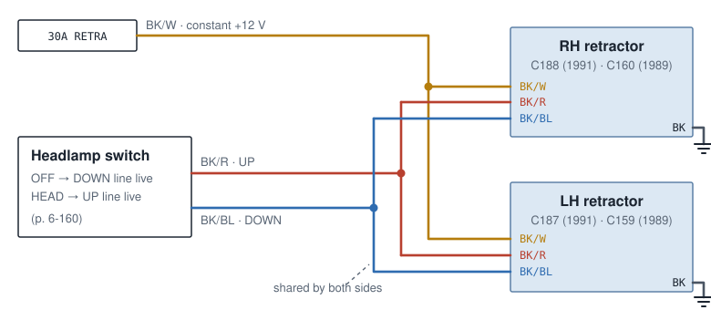
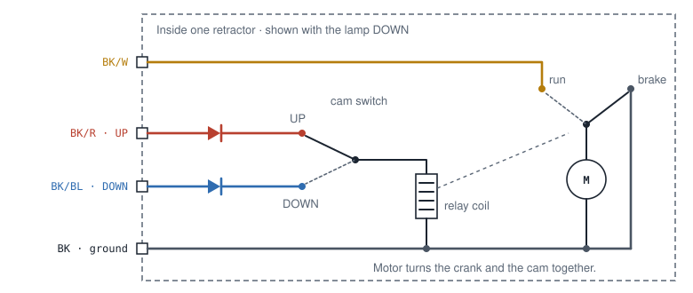
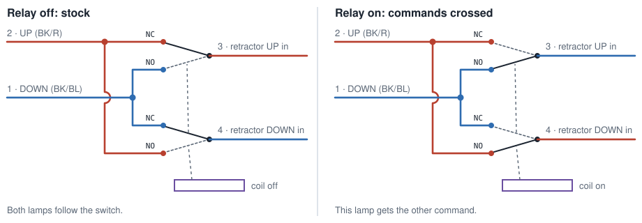
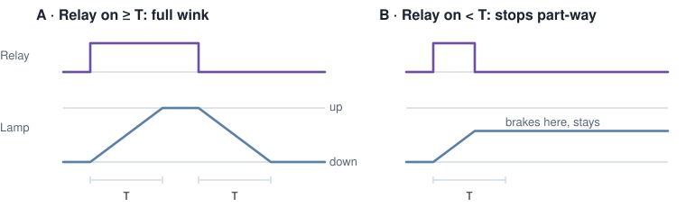
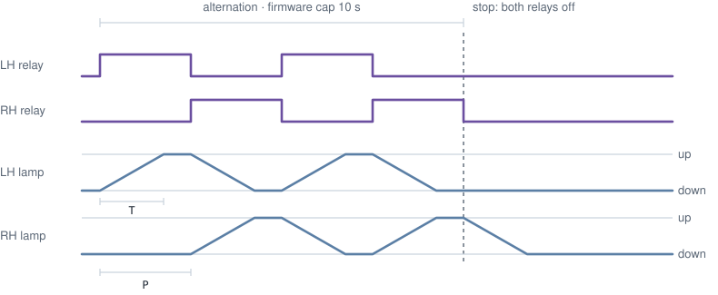
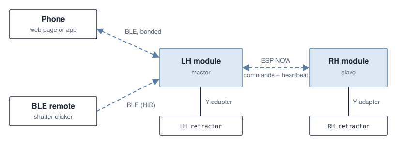
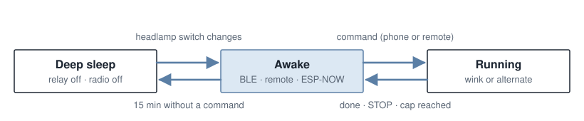
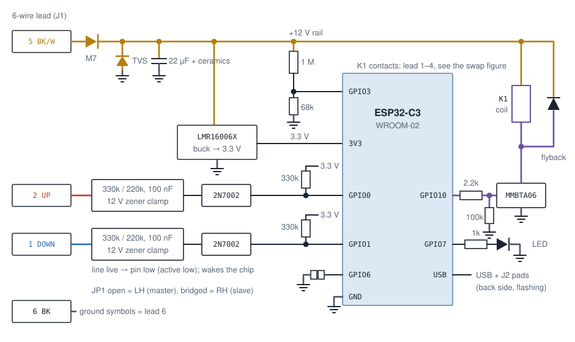

# How it works

## The stock system

Each pop-up headlamp has its own retractor: a motor, a crank, and a small relay
with limit logic inside. Its four-wire plug carries:

| Wire  | Function                                              |
|-------|-------------------------------------------------------|
| BK/W  | motor power, constant +12 V from the 30 A RETRA fuse  |
| BK    | ground                                                |
| BK/R  | UP command                                            |
| BK/BL | DOWN command                                          |

The headlamp switch powers one command line or the other. OFF makes the DOWN
line live. HEAD, and the 4th position (lamps up, lights off), make the UP line
live.

Both retractors hang on the same two command wires. That is the only reason the
two lamps always move together.

*Simplified from the 1991 schematic (manual p. 6-154) and the headlamp switch
(p. 6-160). The 1989 sheet (p. 6-60) shows the same four wire colours at
different connector numbers.*

### Inside one retractor

The motor always turns the same way and drives the lamp through a crank. A cam
switch on the motor decides which command input can reach the relay coil. With
the lamp down, the cam sits on the UP contact. With the lamp up, it sits on the
DOWN contact. A command that matches the lamp's position goes nowhere, so the
motor only runs when the command and the lamp disagree.

*Cycle from lamp down: power on BK/R passes the cam and energizes the coil. The
relay moves from "brake" to "run" and feeds BK/W to the motor, so the lamp rises.
At the top the cam flips to DOWN, the coil drops out, and the relay falls back to
"brake", which shorts the motor so it stops.*

The diagrams were read from low-resolution grayscale scans. The layout is clear;
the diode direction and the polarity of the command lines are inferred, not
read. Test connector C1022 carries BK, BK/W and BK/BL, which fits +12 V
commands. The swap works with either polarity, but the module's sense inputs
and wake logic assume +12 V commands. Measure before building
([testing.md](testing.md#measure-on-the-car-first)).

## The swap

Each module sits in one retractor's command lines and swaps them with a DPDT
relay. The module connects through a Y-adapter between the factory plug and the
retractor ([installation.md](installation.md)); motor power and ground pass
straight through the adapter.

- **Relay off:** the retractor gets the stock commands. This is also the state
  at power-up, during reset, in deep sleep and without a module at all.
- **Relay on:** that retractor gets the opposite command from its partner. It
  travels to the other end and stays there.
- **Relay off again:** the stock command comes back and the lamp returns.

Each common only ever touches one harness line, so the two shared lines are
never bridged. The swap works whatever the polarity of the command lines.

| Headlamp switch  | Live line | That side's relay | That lamp           |
|------------------|-----------|-------------------|---------------------|
| OFF              | DOWN      | off               | down, like stock    |
| OFF              | DOWN      | on                | rises, stays up     |
| OFF              | DOWN      | on → off          | returns down        |
| HEAD / 4th pos.  | UP        | off               | up, like stock      |
| HEAD / 4th pos.  | UP        | on                | drops, stays down   |
| HEAD / 4th pos.  | UP        | on → off          | returns up          |

With the lights on, a lamp winked down stays lit and shines into the hood
cavity. The 4th switch position (lamps up, lights off) avoids that.

## Timing

A relay must stay on until its lamp has finished travelling. If it drops early,
the cam has not flipped yet, so the stock command finds no path: the coil
releases and the motor brakes wherever the lamp is. The next command (a switch
change or another wink) finishes the move, so nothing gets stuck for good. This
follows from the circuit; it has not been tried on the car.

*T is the stock travel time of one lamp. The manual gives no figure; it has to be
timed on the car. Not to scale.*

*Alternation with the switch OFF. The master energizes LH and RH in turn, each
for a half-period P. At every change one lamp drops while the other rises. At
the end, or on STOP, both relays go off and each lamp returns to the switch
position. With the switch on HEAD the picture is the same, upside down.*

The firmware values (`firmware/wink-core/src/config.rs`):

| Setting           | Value                                     |
|-------------------|-------------------------------------------|
| T (`travel_ms`)   | 800 ms, a placeholder until measured      |
| Wink hold         | T + 500 ms dwell                          |
| Half-period P     | max(1200 ms, ⌈1.3 × T⌉)                   |
| Alternation       | `ALT n` runs ⌊n · 1000 / P⌋ whole phases (at least one), LH first; n is capped at 10 s |
| Rest              | 20 s after every alternation; `ALT` is refused during it, winks still work |

An alternation always ends on a phase boundary, so the last lamp has finished
its travel. STOP is the exception: it drops all relays at once, even
mid-travel, and a lamp may then stop part-way.

## Two modules, one system

Both modules run the same firmware. A solder jumper on the board picks the role
at boot: open = LH (master), bridged = RH (slave).

- The **LH module** (master) holds the Bluetooth links to the phone and the
  remote, runs all timing, and tells the RH module what to do.
- The **RH module** (slave) switches its relay only when the master says so.
- The link is ESP-NOW, Espressif's direct radio link. Frames are broadcast and
  carry a truncated HMAC-SHA256 with a shared key, plus an epoch and sequence
  number against replays. Details: [firmware/README.md](../firmware/README.md#esp-now-authentication).
- While the RH relay should be on, the master sends a heartbeat every 200 ms.
  The RH module drops its relay if 1 s passes without one. Losing the link, or
  the master, therefore ends a wink on the RH side within about a second.

No wires run between the two sides or into the cabin.

### Safety layers on each module

Each module enforces these on its own, whatever the commands say:

1. **Supply gate.** The relay is only switched on when the +12 V rail is inside
   the energize band (minimum between 10.0 V and 11.9 V depending on
   temperature, maximum 16.5 V). An energized relay is released only outside a
   wider hold band (9.0 V to 16.8 V), so the motors' own supply dip does not cut
   a running wink. See [design-notes.md](design-notes.md#temperature-scaled-undervoltage).
2. **On-time limit.** A relay is never on longer than 12 s in one go.
3. **Heartbeat watchdog** (RH only): no heartbeat for 1 s, relay off.
4. **Hardware default.** A 100k pull-down holds the relay driver off through
   boot, reset and sleep; the firmware also holds the pin low in deep sleep.
5. **Task watchdog.** A stuck control loop reboots the module after 5 s.

## Power and sleep

BK/W is fed from the RETRA fuse and is live with the key out (per the
schematic; to be confirmed on the car), so both modules are always powered.
They spend almost all their time in deep sleep and wake when the headlamp
switch changes.

- **Going to sleep.** 15 min after the last command (phone or remote), with no
  relay on, no mode running and no remote pairing, the master tells the slave
  to sleep and both deep-sleep. The slave also sleeps on its own 15 min after
  the last valid frame from the master. While awake, the master pings it every
  5 s.
- **Waking.** Before sleeping, each module checks both command lines and arms a
  wake on the dead one(s):

  | UP line | DOWN line | Wake armed on                          |
  |---------|-----------|----------------------------------------|
  | live    | dead      | DOWN going live                        |
  | dead    | live      | UP going live                          |
  | dead    | dead      | either (switch unpowered, e.g. key out) |
  | live    | live      | 60 s timer (should not happen)         |

Both modules see the same command lines, so one switch change wakes both. In
practice: flick the lamps up, or go to the 4th position, and the system is
ready for 15 minutes. Whether the switch powers the command lines with the key
out is still to be measured; if it does not, the modules only wake with the
key in.

## The module

One board per side, 46 × 40 mm, built around an ESP32-C3-WROOM-02:

- **Input:** M7 reverse-polarity diode, SMCJ30A TVS, 22 µF bulk and ceramic
  capacitors. The 1 A fuse sits in the adapter's BK/W tap.
- **Supply:** LMR16006X buck from the +12 V rail to 3.3 V.
- **Relay:** TE IM06GR DPDT, 12 V coil, driven by an MMBTA06 NPN from GPIO10.
- **Sense:** each harness command line goes through a divider, filter and zener
  clamp to a 2N7002 buffer. A live line pulls GPIO0 (UP) or GPIO1 (DOWN) low;
  these pins also wake the chip.
- **Supply sense:** 1 M / 68k divider to GPIO3 (ADC) for the supply gate.
- **Other:** status LED on GPIO7, side jumper JP1 on GPIO6, native USB and
  boot pads on the back for flashing.

Full circuit and layout notes: [pcb/README.md](../pcb/README.md). Pin table:
[firmware/README.md](../firmware/README.md#pins-esp32-c3-wroom-02-board-hardware-rev-c).
