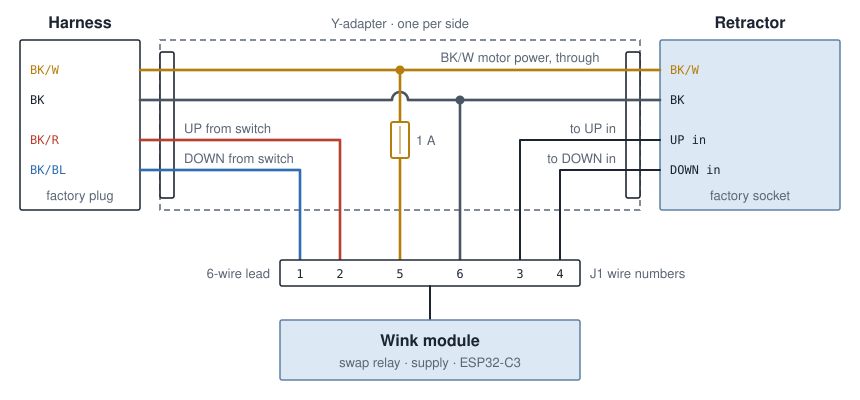
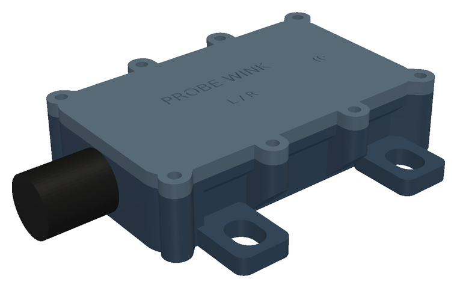

# Installation

One module and one Y-adapter per headlamp. Nothing is cut: the adapter plugs in
between the factory plug and the retractor, and unplugging it restores the stock
wiring.

> **Before you start.** Disconnect the negative battery cable. The retractor
> linkage is strong enough to hurt; keep your hands clear whenever it has
> power. This applies to the 1989–92 Probe only; the 1993+ car is a different
> design.

## The factory connector

| Wire  | Function                     | Source in the manual         |
|-------|------------------------------|------------------------------|
| BK/W  | motor power, constant +12 V, 30 A RETRA fuse | p. 6-150 (1991 fuse block) |
| BK    | ground                       | p. 6-154                     |
| BK/R  | UP command from the headlamp switch   | p. 6-154, p. 6-160  |
| BK/BL | DOWN command from the headlamp switch | p. 6-154, p. 6-160  |

Connector numbers differ by year: C188 (RH) and C187 (LH) on the 1991 sheet,
C160 and C159 on the 1989 sheet. The wire colours match across the sheets
checked. Wire colours are the reliable reference; check them on your car.

Manual pages (Chilton Ford Probe 1989–92 Repair Manual, No. 8266):

| Page          | Content                                                        |
|---------------|----------------------------------------------------------------|
| 6-42 – 6-44   | headlight removal, manual retractor handle (Fig. 97)           |
| 6-60          | 1989 schematic: retractors C160 / C159                         |
| 6-130         | 1990 schematic: retractors                                     |
| 6-150         | 1991 fuse block: 30 A headlamp retractor fuse (BK/W)           |
| 6-154         | 1991 schematic: retractor internals, C188 / C187, test connector C1022 |
| 6-160         | 1991 headlamp switch: OFF / PARK / HEAD, BK/R and BK/BL outputs |
| 10-8 – 10-9   | retractor motor removal and installation                       |

## The Y-adapter

The adapter has a socket that takes the car's plug at one end and a plug that
fits the retractor at the other:

- **BK/W and BK** pass straight through. They carry the motor current, so use
  wire no thinner than the factory harness.
- **BK/W** is also tapped through a **1 A inline fuse** to lead wire 5. Put the
  fuse close to the tap point. It protects the lead, and the module's input
  protection relies on it to end a load dump ([pcb/README.md](../pcb/README.md#circuit-notes)).
- **BK** is tapped to lead wire 6.
- **BK/R and BK/BL** do not pass through. Both ends of each go to the module:

| Lead wire | Silkscreen at J1 | Adapter connection                          |
|-----------|------------------|---------------------------------------------|
| 1         | DN               | BK/BL from the car's plug (DOWN from the switch) |
| 2         | rU               | BK/R pin of the retractor (UP input)        |
| 3         | UP               | BK/R from the car's plug (UP from the switch)    |
| 4         | rD               | BK/BL pin of the retractor (DOWN input)     |
| 5         | 12V              | BK/W tap, through the 1 A fuse              |
| 6         | GND              | BK tap                                      |

Use the same wiring on both sides; the modules differ only in the side jumper.

The repo does not yet name part numbers for the two mating halves of the factory
retractor connector. Seal every joint in the adapter (adhesive-lined heat
shrink), since it lives in the engine bay.

## The module lead

The lead is a sheathed 6 × 0.5 mm² cable (for example LiYY 6×0.5, about
6.2 mm OD), held by the housing's M12 cable gland. It carries signal-level
current only: the relay contacts switch the retractor's command inputs, and the
motor current stays in the adapter. Soldering it into the board:
[building.md](building.md#2-the-lead).

## Mounting the module

- The housing body is about 84 × 45 × 22 mm (90 × 86 mm over the ears and the
  gland). It mounts with four M5 bolts through slotted ears, each with a penny
  washer (ISO 7093, 15 mm OD) and a compression limiter (steel or brass tube,
  8 OD × 5.3 ID × 4.9 mm) so the bolt does not crush the plastic.
- Best orientation: on a vertical panel, gland end down. Mounted floor-down,
  the gland points sideways; both work.
- Put it near the headlamp connector, clear of the radiator and the retractor
  linkage, and give the lead strain relief.
- The antenna is at the end opposite the gland (marked on the lid). Keep metal
  away from that end. The front fascia is plastic; the radio range from inside
  the cabin has not been tested.
- Heat: the ESP32-C3-WROOM-02-N4 is rated to 85 °C ambient. The relay also
  needs more voltage when hot, so the firmware raises its minimum supply with
  temperature (up to 11.9 V on the rail). The front of the bay should run
  cooler than the engine side; measure on a hot day before trusting a spot.

## Side jumper

JP1 is a solder jumper on the back of the board:

| JP1     | Role                                  |
|---------|---------------------------------------|
| open    | LH module, master (phone and remote connect to it) |
| bridged | RH module, slave                      |

The side is read once at boot. Bridge it on the RH board before closing the
housing, and mark the lid (it carries an "L / R" field).

## First power-up

1. Bench-test both modules first ([testing.md](testing.md#bench-test-of-a-built-module)).
2. Plug both adapters in, LH module on the LH retractor. Reconnect the battery.
3. Check stock behaviour: with the modules asleep or idle, both lamps follow the
   headlamp switch exactly as before.
4. Flick the switch to wake the modules. They now advertise as `PWink-L` and
   `PWink-R` for 15 minutes.
5. In the Android app, Settings: choose the LH module, then **Couple modules**:
   choose the RH module and tap Couple. Android asks for the passkey once per
   module. The app writes one new random key to both and checks that the LH
   module hears the RH one. Until then only the LH lamp can move.
6. Optionally pair a BLE remote (Settings → Pair a remote).
7. Run the in-car checks in [testing.md](testing.md#in-the-car).

## If something goes wrong

- **A lamp stopped part-way:** cycle the headlamp switch once.
- **A lamp will not move at all:** the manual crank is under the front fascia
  (manual Fig. 97, p. 6-44).
- **Back to stock:** unplug the adapter and plug the factory plug straight into
  the retractor.
